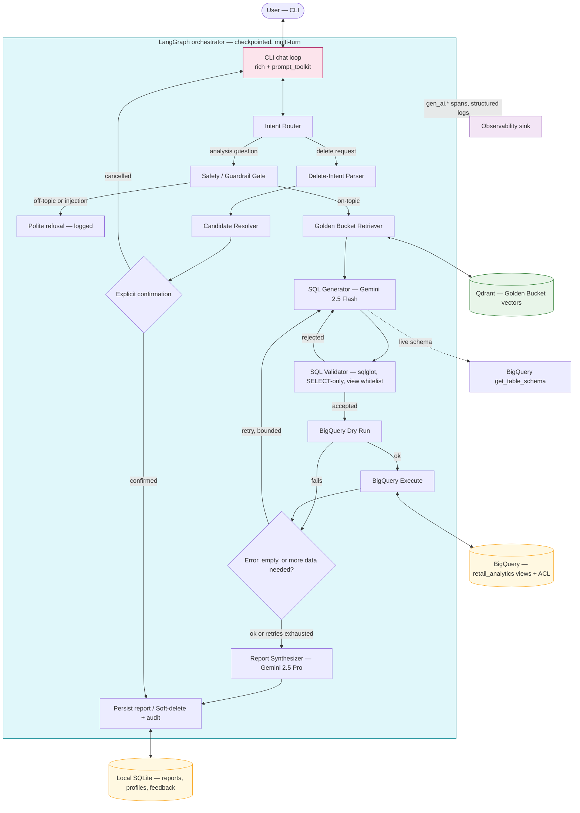
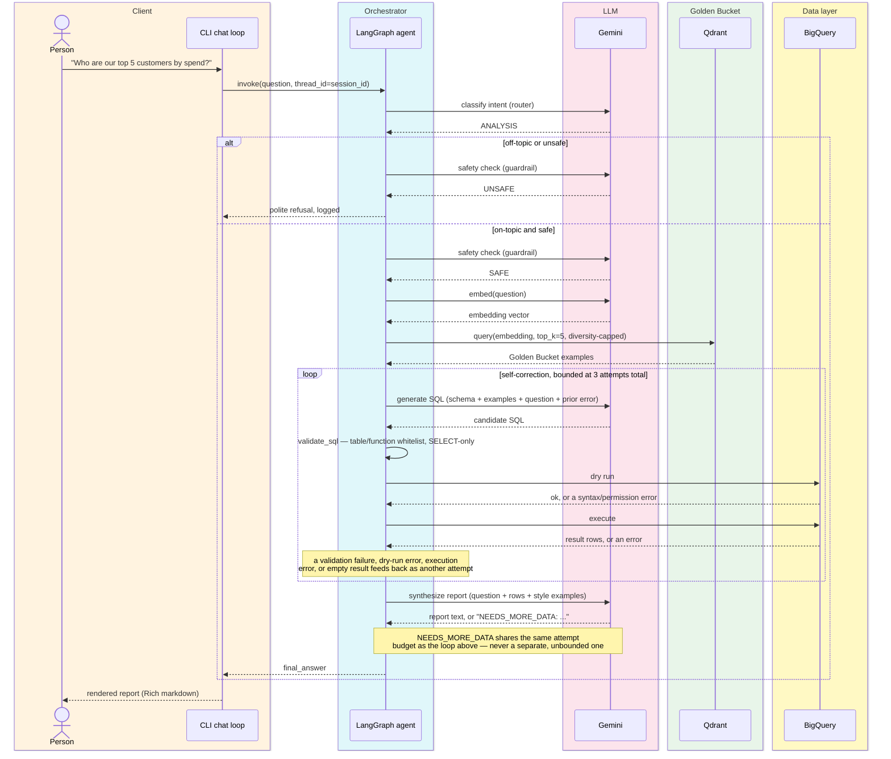

# Architecture — Retail Data Analysis Chat Agent

This is the HLD and detailed technical explanation for the OpsFleet retail
data-analysis chat agent. [PLANNING.md](../PLANNING.md) is the day-by-day roadmap and
decision log; this document is the durable design artifact that roadmap builds toward.
Sections (a)–(d) below are drafted now and finalized Day 7 per the roadmap; the
requirements-traceability table at the end maps every numbered requirement in the brief
to where it's actually addressed.

## 1. System diagram

## 1a. Turn sequence (Day 4, as actually built and run)

Same graph as above, shown as the message sequence for one real turn — the two
branches are exactly what `src/retail_agent/graph.py` does, verified by running the
live CLI, not just designed on paper (see PLANNING.md's Day 4 results for the transcripts).

## 2. Data flow walkthrough (one turn, end to end)

1. The CLI sends the user's message plus `session_id`/`app_user_id` into the LangGraph
   graph; the checkpointer loads prior turn state for that session.
2. **Intent Router** classifies the message as an analysis question or a delete request
   (requirement 3) and branches accordingly.
3. **Analysis path:** the **Guardrail Gate** rejects off-topic or injection-shaped input
   before any SQL is generated (requirement 2's "safeguarded against malicious users") —
   a rejection is logged and never reaches SQL generation. On-topic questions go to the
   **Golden Bucket Retriever**, which embeds the question (`gemini-embedding-001`) and
   queries Qdrant for the top-k most similar past question → SQL → report trios.
4. The **SQL Generator** (Gemini 2.5 Flash) gets: the user's question, the retrieved
   trios as few-shot context, live schema from `BigQueryRunner.get_table_schema`, and the
   `app_user_id` for the turn.
5. The **SQL Validator** (`sqlglot`) parses the generated SQL and rejects anything that
   isn't a single `SELECT` against the `retail_analytics` whitelist (the governed views
   and the two per-user table functions — see §4, "Data layer design"). A rejection loops
   back to SQL generation with the validator's reason as feedback.
6. Accepted SQL gets a **BigQuery dry run** (catches cost/syntax problems before
   spending a real query) and then executes for real.
7. **Self-correction and multi-step queries:** this same bounded loop handles two
   different triggers, not just one. A dry-run failure, execution error, or an empty
   result feeds the error back into SQL generation for a retry (requirement 5). A
   *successful* query can also loop back here — the Report Synthesizer can flag that one
   result set isn't enough to actually answer the question (comparative/causal questions
   like the brief's own "why did churn spike last month" or "how does state X compare to
   state Y" routinely need a second query — a different breakdown, a different time
   window — not a different attempt at the same one), requesting one more query with a
   stated reason. Both triggers share one retry budget (Day 4 default: 2) so a vague
   multi-step question can't quietly turn into an unbounded query loop; once the budget
   is exhausted, the graph synthesizes the best answer it can from what it already has, or
   falls back to a graceful "I couldn't fully answer that" — never a crash or a silent
   infinite retry.
8. The **Report Synthesizer** (Gemini 2.5 Pro) turns the result set into an
   analyst-style report — insights *and*, when the user asked for a report (not just a
   quick answer), concrete action items, not insights alone — shaped by the requesting
   user's `user_profiles` preferences (requirement 4a).
9. The report is **persisted** to `saved_reports` (local SQLite) with the session id and
   an extracted client/entity mention list, then returned to the CLI.
10. **Delete path** (requirement 3): the **Delete-Intent Parser** extracts the target —
    either a content filter ("mentioning Client X") or "this conversation" — and the
    **Candidate Resolver** looks up matching, non-deleted reports scoped to the
    requesting user's own `app_user_id` (never another user's reports). The graph then
    **interrupts**, showing the exact candidate list and count, and waits. On explicit
    confirmation it soft-deletes and writes an audit row; on cancellation nothing changes
    and the turn ends normally — see §5, "Destructive-op resolution semantics" for the
    exact two-case logic.

## a. Cloud services and framework reasoning

- **Orchestration — LangGraph.** [ADR-001](decisions/ADR-001-orchestration-framework.md).
  Its `interrupt()`/`Command` resume primitive, backed by a checkpointer, is close to a
  direct implementation of the destructive-ops confirmation requirement. **Experience
  level:** prior hands-on LangGraph/LangChain work building a multi-agent
  supervisor/document-analyzer system with a RAGAS-based eval harness — this project's
  framework choice is grounded in that, not a from-scratch pick.
- **LLM — Gemini via Google AI Studio.** [ADR-002](decisions/ADR-002-llm-provider.md).
  Required for grading; direct `google-genai` SDK calls from LangGraph nodes, not the
  LangChain wrapper, for full control over structured output during SQL generation.
- **Vector store — Qdrant.** [ADR-003](decisions/ADR-003-vector-store.md). Embedded/local
  mode for the prototype, same client API as a real Qdrant deployment in production.
- **Data warehouse — BigQuery**, required by the brief; `bigquery-public-data.thelook_ecommerce`
  is the source, `retail_analytics` (our own dataset) is the only thing the agent's
  service account can see — see §4 below.

## b. Data flow

Covered in full in §2 above (this doc's §1–2 *are* technical-explanation section b).

## c. Error handling and fallback strategy

| Failure | Handling |
| --- | --- |
| Generated SQL fails validation | Loop back to SQL generation with the validator's rejection reason as feedback; bounded retries (Day 4 default: 2), then a graceful fallback message — never a stack trace to the user. |
| BigQuery dry run / execution error, or an empty result | Same bounded self-correction loop as above (requirement 5). The dry run exists specifically to catch most of this *before* a billed execution, keeping the retry loop cost-bounded. |
| Question needs more than one query to actually answer (a comparison, a "why") | Same loop and same budget, triggered by the synthesizer instead of an error — see §2 step 7. Sharing the budget keeps "needs more data" from becoming a way around the retry cap. |
| Gemini or BigQuery call fails transiently (timeout, 5xx, rate limit) | `tenacity`-based retry with exponential backoff and a circuit breaker per external call; distinct from the SQL self-correction loop above, which handles *logical* SQL failures, not *transport* failures. |
| Retry budget exhausted | Graceful "I couldn't answer that" response, logged with the guardrail/observability metadata (requirement 7) for later debugging — the conversation continues normally on the next turn, never crashes the CLI. |
| Per-turn cost/token runaway | A token/cost budget guard aborts a turn that exceeds its budget rather than letting a retry loop inflate costs silently (explicit brief concern under requirement 5). |
| Destructive-op candidate set is empty | The confirmation step still fires, showing "0 reports match" — the user gets a clear answer, not a silent no-op. |
| Destructive-op cancelled | No state change; audited as `delete_cancelled` in `report_audit_log` so the attempt itself is visible later, not just confirmed deletions. |

## d. Setup instructions (skeleton)

Finalized Day 7 once the CLI exists; the install/run instructions live in the
[README](../README.md#development-setup) and will be extended with a pasted example run
transcript once Day 4's CLI loop exists. Two environment variables
(`GOOGLE_CLOUD_PROJECT`, `GEMINI_API_KEY`) are the only required setup beyond `pip
install`, per [.env.example](../.env.example).

## 3. Requirement 1 deep dive — Golden Bucket update and retrieval mechanics

**Retrieval at query time:** the user's question is embedded with `gemini-embedding-001`
and queried against Qdrant's `golden_bucket` collection (cosine similarity, top-k with a
diversity constraint — not just raw nearest-neighbor — so retrieved examples span
different phrasings/capability areas rather than k near-duplicates of the same trio).
Each point's payload carries `{question, sql_query, report_summary, capability_area,
status, created_at}`; retrieval filters `status = "approved"` so a trio that hasn't
cleared human curation never reaches live generation.

**Update over time (requirement 1's explicit "how"):** Day 6's feedback loop is the
update path — a 👍-rated answer to a *novel* question (one that didn't already have a
close Golden Bucket match) is written as a `status = "candidate"` point, never directly
promoted. A human analyst reviews the candidate queue and flips it to `"approved"` before
it can influence a future turn. This is deliberately human-gated (not auto-ingested): an
unreviewed update path is a prompt-injection / bad-feedback vector into the few-shot set
that steers every future user's SQL generation, which is a bigger blast radius than one
bad answer.

## 4. Data layer design

Full DDL lives in [sql/bigquery_views.sql](../sql/bigquery_views.sql) (BigQuery) and
[sql/app_state.sql](../sql/app_state.sql) (local SQLite); both are applied live, not just
designed (Day 3/4 results in PLANNING.md), and are referenced, not duplicated, below.

**Split rationale.** AGENTS.md locks "BigQuery is read-only and stays read-only" for the
agent's own runtime. Four things the brief needs — `saved_reports`, `user_profiles`,
`feedback`, and the Golden Bucket's curation state — all need live **writes** during a
normal conversation turn, which would violate that lock if they lived in BigQuery. So:

| Store | Holds | Written by the live agent? |
| --- | --- | --- |
| BigQuery (`retail_analytics` dataset) | Governed views over the 4 source tables (internal only — see below), `user_brand_access` ACL, 4 brand-scoped table functions | No — SELECT only. `user_brand_access` is seeded once by an admin script, same as the views are created once. |
| Local SQLite | `saved_reports`, `report_audit_log`, `user_profiles`, `feedback`, the LangGraph checkpointer | Yes — this is exactly the state a conversation turn needs to read and write. |
| Qdrant | Golden Bucket trios (question, SQL, report, capability area, curation status) | Yes, but only through the Day 6 candidate-then-approve path, never a direct write from a live turn's own output. |

**PII masking (requirement 2, part 1).** `vw_users_masked` simply never selects the hard
PII columns found in the Day 1 inventory. This is enforced at the view definition, not by
instructing the model — the columns are not *in the result set* a generated query can
possibly return, regardless of what the LLM asks for upstream of it. BigQuery
column-level policy tags were the original plan ([PLANNING.md](../PLANNING.md)'s decision
table); they don't apply here because `bigquery-public-data` isn't a dataset we own, so
there's nothing of ours to attach a policy taxonomy to. Omission at the view layer
achieves the same "never retrievable" guarantee without that machinery.

**Per-brand ACL (requirement 2, part 2) — confirmed answer, 2026-11-19.** Asked the
client directly rather than guessing further: access is by **brand**, not category
("each manager can analyze only the brands they manage, and the CEO sees everything"),
and **order/customer data is visible only through a purchase of an in-scope-brand
product** — a broader rule than originally designed. See the table-function comments in
`sql/bigquery_views.sql` and [ADR-004](decisions/ADR-004-per-user-product-acl.md) for the
full before/after. In short: BigQuery's native row access policies key off the querying
IAM principal, but every app user shares one service account, so BigQuery itself can't
tell them apart. The fix is four parameterized table functions
(`fn_products_for_user`, `fn_order_items_for_user`, `fn_orders_for_user`,
`fn_customers_for_user`) where the orchestration code (never the LLM) supplies the
authenticated `app_user_id`, combined with a SQL validator that only ever allows a
generated query to call one of these four — never a raw `SELECT` against any `vw_*` view.
`'ceo'` is a reserved id that bypasses the brand check in every function, rather than
being seeded with all ~2,800 brands.

## 5. Destructive-op resolution semantics (requirement 3)

The brief gives two example inputs that must both work, and they resolve differently —
this is a design decision made explicitly now, not improvised at Day 5's implementation:

- **"Delete all reports mentioning Client X"** — a **content-match** delete. The
  Candidate Resolver searches the requesting user's own (non-deleted) `saved_reports` for
  "Client X". **Implementation note (Day 5):** this design originally called for
  `client_mentions` to hold an entity list extracted at report-creation time, matched
  against at delete time. Built simpler instead: `client_mentions` stays in the DDL
  (unused) and the resolver runs a direct `LIKE` against `title`/`body` at delete time —
  this dataset has no real "client" entity to extract in the first place (brand name is
  the closest analog, and the question text itself already names it), so a separate
  extraction step would add a moving part without a real entity to extract. A genuine
  client-tagging feature would re-introduce the column and the extraction step this
  design originally called for.
- **"Delete all the reports we made in this conversation"** — a **session-scoped**
  delete. The Candidate Resolver filters by `session_id` on the current conversation,
  never by re-matching report content — "this conversation" is a structural fact the
  system already tracks, not something to infer from text.

Both paths converge on the same confirmation step: `interrupt()` shows the exact
candidate list (title + id, not just a count) and requires an explicit "yes" before any
write. Both are always scoped to `app_user_id = <requesting user>` — the resolver query
itself excludes other users' reports, so there's no separate "can I see this report"
check to forget. A cross-user delete attempt simply resolves to an empty or
partial candidate set, which the confirmation step surfaces honestly ("0 reports match")
rather than silently failing or revealing another user's report titles.

**Confirmation integrity.** The "yes" that resumes an `interrupt()` is a raw CLI input
string, checked by orchestration code against an explicit allow-list (`yes`/`y`, exact
match, case-insensitive) *before* the delete executes — not an LLM's judgment call about
whether the conversation "sounds like" agreement. This closes the obvious prompt-injection
angle on the one requirement the brief calls "high-stakes": a crafted message earlier in
the conversation can't talk the model into treating something as confirmed that the user
never actually typed, because the model is never the thing deciding whether it was
confirmed.

## 6. Requirement 6 deep dive — quality assurance approach

Implemented Day 6 (`scripts/run_eval.py`, `data/eval_regression_set.yaml`); see
[PLANNING.md](../PLANNING.md)'s Day 6 results for the actual numbers.

- **SQL execution accuracy** — does generated SQL run without error and return a
  non-empty result for questions that should have one, against a held-out regression set
  of questions distinct from the Golden Bucket's own few-shot examples (testing
  generalization, not memorized retrieval).
- **Result correctness** — regression-set questions get a known-correct expected answer
  (computed once, by hand, against the real data) to diff the agent's result against.
  **Real lesson from building this (Day 6):** the first hand-computed expected value for a
  "revenue this year" question didn't itself apply a "this year" filter, so it flagged a
  *correct* agent answer as wrong -- caught by actually re-verifying the failing case
  against live BigQuery rather than assuming the harness was right. The fix was to the
  regression set's own ground truth, not the agent.
- **Report quality** — an LLM-as-judge rubric (faithfulness to the underlying data,
  relevance to the question asked, clarity) for the parts correctness alone can't capture.
- **UX evaluation** — manual QA pass (Day 7) across edge cases: ambiguous questions,
  injected SQL errors, simulated API downtime, off-topic/adversarial prompts, a
  destructive op with zero matches, a destructive op the user cancels, and cross-user ACL
  probing — see [PLANNING.md](../PLANNING.md)'s Day 7 section for the full list.

## 7. Requirement 7 deep dive — observability

Implemented Day 6 (`src/retail_agent/telemetry.py`, `agent_events` in
`sql/app_state.sql`, `scripts/metrics_rollup.py`):

- **Per-turn:** SQL self-correction retry count, guardrail-block flag, per-node and
  end-to-end latency, whether the turn ended in a graceful fallback.
- **Per-session:** turn count, destructive-ops attempted vs. confirmed vs. cancelled,
  feedback rate (👍/👎 per answer given).
- **System-level (rollup):** SQL success rate, average self-correction retries, guardrail
  block rate.
- **Simplified from the original plan:** token/cost spend (per-turn and per-session) was
  cut for time, the same documented tradeoff as Day 4's budget guard --
  `LLMClient.generate()` doesn't expose token usage yet, so there's nothing to roll up
  without first extending that interface. Bounded self-correction attempts (`generate_sql`
  retries) already bound cost by construction even without a precise dollar figure.

**Deep-dive/debugging support:** every node emits an OTel-style span (`gen_ai.*`-style
attributes) plus a structured JSON log line, correlated by `session_id`/`turn_id`/
`trace_id` (`trace_id` equals `turn_id` in this prototype -- one process, no distributed
call graph to disambiguate, so a second id would track one-for-one with `turn_id` and add
nothing real). Pulling a `trace_id` surfaces every node's execution in order -- which
node ran, how long it took, and a curated set of outcome attributes (the generated SQL
text on the SQL-pipeline nodes, row counts, error/blocked flags, retry counts) -- "what
went wrong," not just "something went wrong," satisfying the brief's explicit
"understanding what the message correspondence is." **Scoped down from the original plan:**
the full synthesized report text is deliberately *not* duplicated into every trace line
(it's recoverable from `saved_reports`/`feedback` for any turn that needs it) -- a trace
shows the shape of what happened at each node, not a second copy of the whole
conversation.

**Log/trace safety, not just app safety.** Requirement 2's PII ban doesn't stop at the
user-facing output — a span or log line that captures a node's raw "output" must never
capture a raw BigQuery result row (only row/column counts, timing, and the query text
itself, which is already PII-free since it can only reference the masked views). The
generated SQL text is safe to log in full and is logged in full; query *results* are not.
This is a logging-layer rule (AGENTS.md), not something left to each node to decide case
by case.

## 8. Requirement 8 — persona/agility management

`persona.yaml` (tone, default verbosity, formatting rules) is read fresh at the start of
every turn, not cached for the life of the process — a non-developer edits the file and
the very next turn reflects it, no redeploy. Versioned in git so a bad edit is a `git
revert`, not an incident. Implementation lands Day 5; the mechanism itself (external
config, hot-read per turn) is the full answer to "how," already locked in AGENTS.md.

## 9. Extensibility

The task description asks for a system that's "easily extendable for new capabilities
(generating graphs, sending reports via mail, searching the web for trends, etc.)" — not
one of the 8 numbered requirements, but an explicit design property. Two things already
in this design carry the weight of that, rather than it needing its own subsystem:

- **New capability = a new LangGraph node**, not a restructure. A chart-generation step
  slots in between Execute and Synthesize (render the result set, attach the image);
  "email this report" is a new node after Persist that reads a `saved_reports` row; "search
  the web for trends" is a new retrieval node parallel to the Golden Bucket Retriever,
  feeding its result into the same SQL Generator context. None of these require touching
  the Guardrail Gate, the Validator, or the ACL enforcement — the new node sits inside the
  same checkpointed graph and inherits the same observability spans for free.
- **The `LLMClient`/`VectorStore` interfaces already establish the pattern.** Both exist
  specifically so a provider/infra swap is a new adapter behind an existing interface, not
  a rewrite (AGENTS.md). A new tool node follows the same shape: implement a small, typed
  interface for "what this tool needs and returns," register it as a node, and the rest of
  the graph is unchanged.

## 10. Requirements traceability matrix

| # | Requirement (brief) | Primary component(s) | Where addressed |
| --- | --- | --- | --- |
| 1 | Hybrid Intelligence — Golden Bucket, update over time, retrieval at query time | Golden Bucket Retriever, Qdrant, Day 6 curation loop | §3 above; implemented Day 3 (retrieval), Day 6 (update loop) |
| 2 | Safety & PII Masking — forbidden PII output, per-brand scoping | Guardrail Gate, `vw_users_masked`, the 4 `fn_*_for_user` functions, SQL Validator | §4 above, `sql/bigquery_views.sql`, ADR-004; implemented Day 3 (data layer), Day 4 (guardrail + validator), confirmed and corrected against the client's real answer Day 4 |
| 3 | High-Stakes Oversight — destructive-ops confirmation, scoped to own reports | Delete-Intent Parser, Candidate Resolver, `interrupt()`/`Command`, `saved_reports`/`report_audit_log` | §5 above, `sql/app_state.sql`; implemented Day 5 |
| 4 | Continuous Improvement — user-level + system-level learning | `user_profiles` (4a), Day 6 feedback → Golden Bucket candidate loop (4b) | §3 above (4b), `sql/app_state.sql` (4a); implemented Day 5 (4a), Day 6 (4b) |
| 5 | Resilience & Graceful Error Handling | Self-correction loop, `tenacity` retry/circuit breaker, cost/token guard | §c above; implemented Day 4 |
| 6 | Quality Assurance — evaluation before deployment | Regression set, LLM-as-judge rubric, manual QA pass | §6 above; implemented Day 6 (harness), Day 7 (manual pass) |
| 7 | Observability — failure visibility, metrics, deep-dive support | OTel-style spans, structured logs, metrics rollup | §7 above; implemented Day 6 |
| 8 | Agility — persona management without redeploy | `persona.yaml`, hot-read per turn | §8 above; implemented Day 5 |

**Done-when check (Day 2):** every one of the 8 requirements has a named component and a
named section above — none were silently dropped between planning and this document.

## 11. Open design questions carried into Day 3+

- ~~The "products related to him" scope boundary is a documented interpretation, not a
  confirmed client answer~~ — **resolved 2026-11-19**: access is by brand, and order/
  customer data is scoped through in-scope purchases too. See §4 and ADR-004.
- The exact self-correction retry budget (3 total attempts, per §c) and the per-turn
  cost/token ceiling are Day 4 implementation parameters (the latter simplified to the
  attempt-count bound itself — see PLANNING.md's Day 4 results), not yet tuned against
  real latency/cost numbers at scale.
- `'ceo'` as a literal reserved `app_user_id` is fine for this prototype; a real
  deployment would resolve a CEO/admin role from an actual auth system instead.
